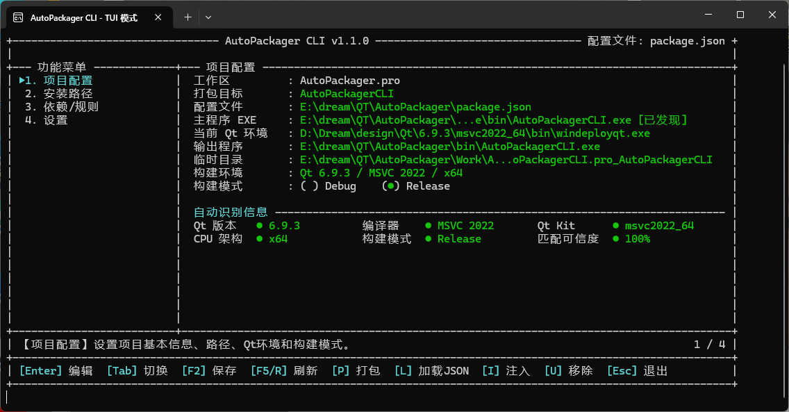
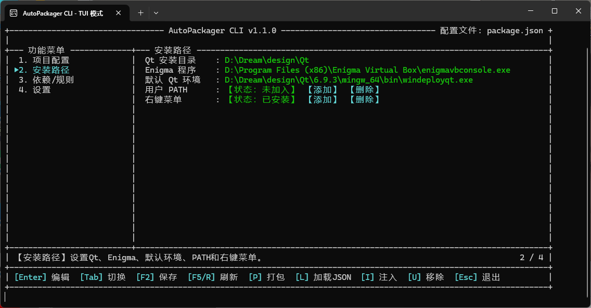
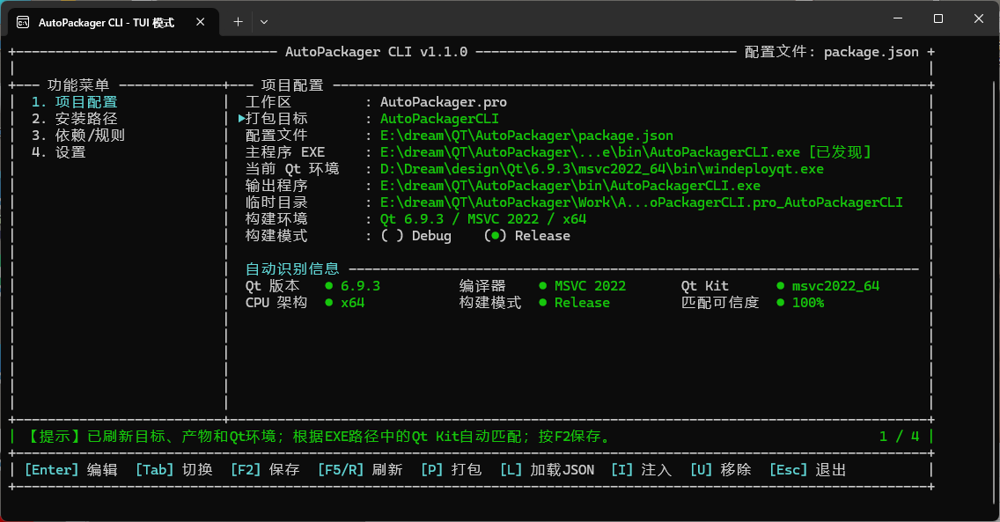
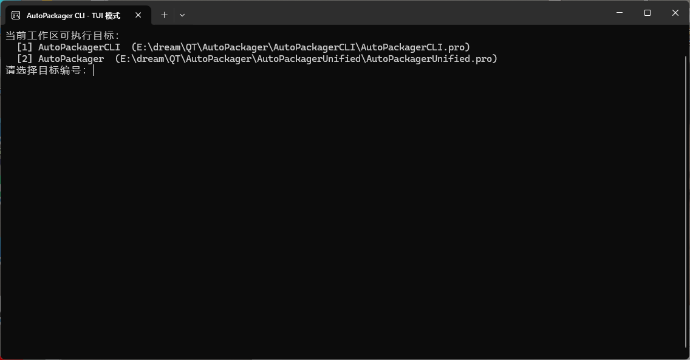
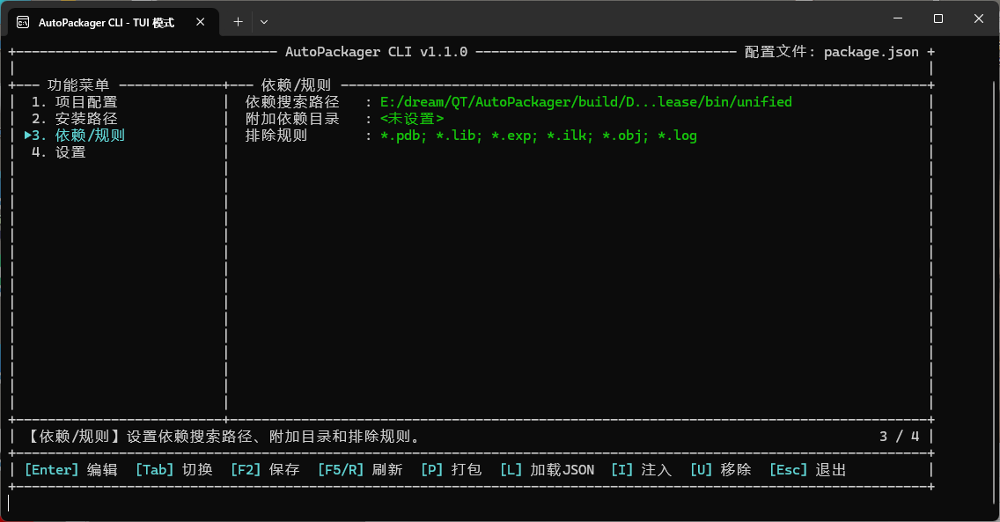
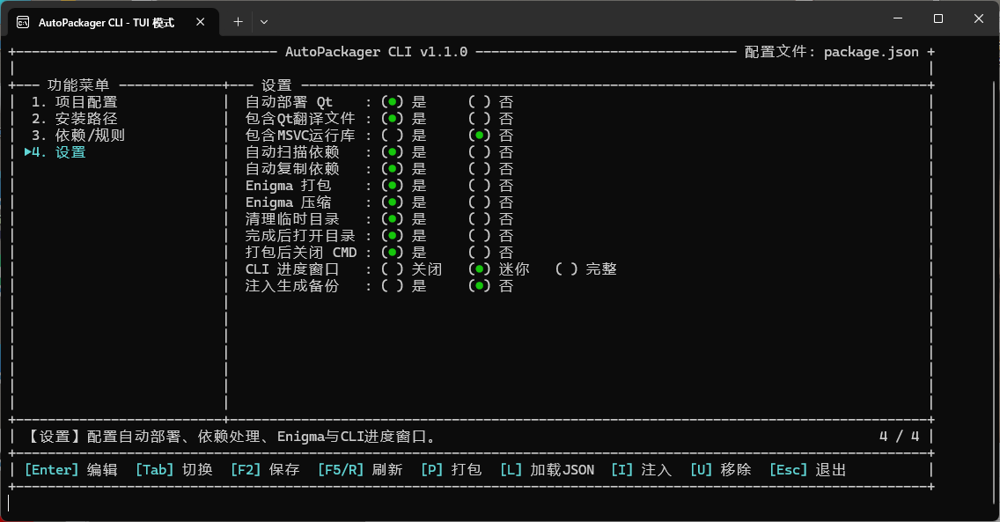

# AutoPackagerCLI

**面向 Windows Qt 工程的自动打包工具：编译前完成配置，构建后自动打包。**

支持单个 EXE、qmake（`.pro`）和 CMake（`CMakeLists.txt`）工程，也支持包含多个可执行子项目的工作区。调用 `windeployqt` 收集 Qt 运行依赖，扫描并补齐第三方 DLL，再按需通过 Enigma Virtual Box 封装为单个 EXE。

既可以使用终端交互界面（TUI），也可以通过命令行接入 Qt Creator 和构建流程。



## 功能概览

- **编译前配置**：根据工程定义预测 EXE 名称和输出位置；尚未生成 EXE，也可以保存 JSON 和注入构建后命令。
- **单项目与多应用**：识别 qmake SUBDIRS 和 CMake 可执行目标；各应用独立打包，库项目作为依赖处理。
- **实际产物校正**：构建后命令传入本次生成的真实 EXE，处理预测与实际输出不同的情况。
- **Qt 环境识别**：支持 Qt 5 / Qt 6、MinGW / MSVC、x86 / x64，匹配主程序使用的 Qt 环境。
- **主动刷新**：在 TUI 按 `F5` / `R`，或使用 `refresh` 命令，重新判断工程目标、当前产物和 Qt 环境。
- **两种输出方式**：Enigma 单文件封装，或关闭 Enigma 后生成包含运行依赖的部署目录。
- **精简配置**：工作区只需一份 `package.json`，公共设置共享，各目标仅保存自身差异。
- **使用入口**：终端交互、命令行、用户 `PATH` 和资源管理器右键菜单。
- **清理与备份**：注入备份默认关闭；移除注入时同步清理对应备份及不再被引用的工作区 JSON。

## 使用前准备

| 使用场景 | 要求 |
| --- | --- |
| 生成工程配置、注入命令 | 有效的 `.pro` 或 `CMakeLists.txt`，无需预先生成 EXE。 |
| 实际部署 Qt 程序 | 已生成的目标 EXE，以及与它匹配、包含 `windeployqt.exe` 的 Qt Kit。 |
| 封装为单个 EXE | 安装 Enigma Virtual Box，配置 `enigmavbconsole.exe`。 |
| 不使用 Enigma | 关闭“Enigma 打包”，以部署目录形式发布。 |

当前支持 Windows。下载本目录中的 `AutoPackagerCLI.exe`，放到固定位置使用。注入命令会引用工具路径，移动工具后需要重新注入。

## 首次设置

打开软件，选择左侧“安装路径”：

1. 设置 Qt 安装根目录，例如 `D:\Qt`。
2. 使用单文件打包时，设置 Enigma 控制台程序，例如 `D:\Program Files (x86)\Enigma Virtual Box\enigmavbconsole.exe`。
3. 选择默认 Qt 环境，作为自动匹配信息不足时的备用环境。
4. 按需添加用户 `PATH` 和资源管理器右键菜单。修改 `PATH` 后请重新打开终端。



安装路径、默认 Qt 环境和注入备份开关属于软件全局设置，修改后立即保存；`F2` 保存的是当前项目的 `package.json`。

## 从项目目录开始

在工作区根 `.pro` 或 `CMakeLists.txt` 所在目录打开终端并运行：

```bat
AutoPackagerCLI.exe
```

也可以直接指定工程：

```bat
AutoPackagerCLI.exe tui --project-file "D:\Project\MyWorkspace.pro"
```

首次识别的新工程默认使用首个可执行目标和 Release 模式；多应用工程可在“打包目标”中切换。请确认主程序、构建环境、模式和输出位置，再进行后续操作。

界面底部的 `[F5/R] 刷新` 对应主动重新识别。完成构建、调整输出目录或切换 Qt Kit 后，可在当前界面刷新，无需退出重开。

### 工程尚未编译

1. 检查“主程序 EXE”状态：`已预测` 表示文件还未生成；`待确定` 表示暂时无法确定路径。
2. 如未识别到构建目录，进入“构建环境”，选择手动输入构建根目录。目录可以尚不存在。
3. 按 `F2` 保存配置，或直接按 `I` 保存当前配置并注入全部可执行目标。
4. 回到 Qt Creator 重新加载工程；必要时重新运行 qmake 或 CMake 配置，再构建所选模式。

命令行也可以在编译前生成配置：

```bat
AutoPackagerCLI.exe init --project-file "D:\Project\MyWorkspace.pro" --build-dir "D:\Project\build" --build-mode Release
```

构建目录应填写该工程实际使用的构建根目录。预测依据包括工程中的目标名、输出目录及已有构建信息；复杂条件或动态表达式可能无法静态确定，但仍可先配置并注入。工具负责打包，不会替代 Qt Creator 编译工程。

### 已有 EXE，立即打包

1. 选择正确目标和 Debug / Release 模式。
2. 确认 Qt 环境、依赖规则和输出位置。
3. 按 `P` 保存当前配置并开始打包。

只打包一个独立 EXE 时，可以在 EXE 所在目录启动软件，或通过命令生成配置：

```bat
AutoPackagerCLI.exe init --main-exe "D:\App\MyApp.exe" --output "D:\App\package.json"
AutoPackagerCLI.exe pack --config "D:\App\package.json"
```

默认输出到项目目录的 `bin`，临时文件位于 `Work`。多应用使用各自的临时子目录；同名目标使用独立输出子目录，避免互相覆盖。独立 EXE 默认以其所在目录作为基准。

## 刷新与重新识别

在以下情况使用刷新：首次构建生成了 EXE、修改了目标名称或输出目录、切换了 Qt Kit，或者新增/移除了可执行子项目。

| 入口 | 操作 | 保存方式 |
| --- | --- | --- |
| 终端交互界面（TUI） | 按 `F5` 或 `R`。 | 只更新当前界面配置，按 `F2` 才写入 JSON。 |
| 命令行 | 执行 `refresh`，可指定配置文件或工程。 | 重新识别后直接保存配置。 |

### 在 TUI 中刷新

1. 选择需要的打包目标和 Debug / Release 模式。
2. 按 `F5` 或 `R`，重新扫描工程和 Qt 环境。
3. 检查主程序路径、产物状态、构建环境和当前 Qt 环境；状态栏会提示刷新结果。
4. 按 `F2` 保存，或继续调整配置。



工程树会重新扫描，产物路径按当前目标和模式重新判断。当前目标仍存在时保留其选择；自动输入会重新选择构建候选，手动指定的主程序、完整输出路径及 Qt 工具继续保留。刷新不会通过重新加载 JSON 覆盖尚未保存的界面设置。

工程尚未编译时，刷新仍可更新预测结果；独立 EXE 则根据实际文件重新识别模式和 Qt 环境。自动 Qt 模式会重新匹配，手动固定的 Qt 工具不可用时需要自行修正。

### 使用刷新命令

```bat
REM 刷新当前目录的 package.json；无配置时尝试识别当前目录工程并创建配置
AutoPackagerCLI.exe refresh

REM 刷新指定配置中的工作区和当前目标，并保存
AutoPackagerCLI.exe refresh --config "D:\Project\package.json"

REM 指定工程、构建根目录、目标与模式，允许尚未生成 EXE
AutoPackagerCLI.exe refresh --project-file "D:\Project\MyWorkspace.pro" --build-dir "D:\Project\build" --target MyApp --build-mode Release

REM 刷新已有配置中的另一个目标，支持 JSON 相对目标键
AutoPackagerCLI.exe refresh --config "D:\Project\package.json" --target "apps/client/client.pro"

REM 刷新独立 EXE 并保存配置
AutoPackagerCLI.exe refresh --main-exe "D:\App\MyApp.exe" --config "D:\App\package.json"
```

- `--config` 指定读取和保存的 JSON；未指定时使用显式工程所在目录或当前目录的 `package.json`。
- `--target` 指定本次刷新的应用，不指定时沿用配置中的目标；其他已配置目标保留各自模式和差异。需要更新其他应用的产物配置时，可切换目标后再次刷新。
- `--build-dir` 必须配合 `--project-file`，填写工程实际使用的构建根目录，目录可以尚不存在。
- 配置无法读取、显式目标无效或指定工程与现有配置工作区不一致时，会报告错误，不直接覆盖配置。

刷新不编译工程、不执行打包，也不注入或移除命令。它更新识别结果，不能代替重新构建；真正打包时仍需检查实际 EXE 和工具环境。

## 构建后自动打包

在项目页选择需要的 Debug 或 Release 模式，按 `I` 即可注入；不必事先手动生成 JSON。

- **默认处理全部可执行目标**：每个应用完成链接后，独立打包自身产物。
- **自动生成缺失配置**：没有 `package.json` 时自动创建；已有配置无法读取时会报错，不会直接覆盖。
- **模式匹配**：选择 Release 注入后，只在对应模式触发；切换模式后需重新保存并注入。
- **真实路径优先**：qmake / CMake 构建后命令传入实际 EXE 路径；成功打包后同步更新该目标的产物信息。
- **CMake 配置**：支持单配置及 Visual Studio 等多配置生成器，按实际构建配置筛选触发。

普通增量构建如果没有重新链接，不会触发打包；需要立即执行时可按 `P`，或在 Qt Creator 中重新构建。

### 多应用工作区

工作区根目录只使用一份 `package.json`。公共选项统一保存，各 EXE 的输入、输出差异和依赖路径独立管理。静态库、动态库不作为主程序封装。



命令行不指定 `--target` 时，`inject` / `uninject` 默认处理全部应用；只处理一个目标时，可传入唯一目标名或 JSON 中的相对目标键：

```bat
AutoPackagerCLI.exe inject --project-file "D:\Project\MyWorkspace.pro" --build-mode Release
AutoPackagerCLI.exe inject --project-file "D:\Project\MyWorkspace.pro" --target MyApp --build-mode Debug
AutoPackagerCLI.exe pack --config "D:\Project\package.json" --target "apps/client/client.pro"
```

同名目标请使用相对目标键或完整目标 ID。qmake 键形如 `apps/client/client.pro`，CMake 键形如 `src/CMakeLists.txt::MyApp`。`--all-targets` 仍可显式使用，不能与 `--target` 同时指定。

### 预测与实际输出不一致

构建后自动打包优先使用构建系统传入的真实路径；自动输出文件名会随真实 EXE 名称调整，用户手动指定的完整输出路径会保留。

手动执行 `P` / `pack` 时，程序会重新核对工程元数据和已确认产物。只有预测路径、文件缺失或信息不足时，会要求重新构建或手动指定主程序；不会仅凭预测路径上存在一个旧 EXE 就认定它是本次产物。

成功打包后的确认信息会回写到当前目标，其他目标配置继续保留。

## 依赖与打包选项

“依赖/规则”页面提供三个不同用途的列表：

| 选项 | 用途 |
| --- | --- |
| 依赖搜索路径 | 为程序导入的第三方 DLL 提供搜索位置。 |
| 附加依赖目录 | 整体复制需要随程序发布的目录，例如资源目录。 |
| 排除规则 | 按通配符排除不需要发布的文件。 |



“设置”页面可调整 Qt 翻译文件、MSVC 运行库安装程序、依赖扫描和复制、Enigma 打包及压缩、临时目录清理、打包完成后的操作与进度窗口形式。



CLI 进度窗口支持关闭、迷你和完整三种形式。关闭 Enigma 后，输出目录中会保留主程序及运行依赖，发布时需要一起分发。

### 注入备份与移除

默认不生成 `.autopackager.bak`。需要备份时，可在“设置 → 注入生成备份”中开启，或执行：

```bat
AutoPackagerCLI.exe settings set --project-backup on
AutoPackagerCLI.exe settings set --project-backup off
```

该开关与 AutoPackagerUnified 共用。按 `U`，或运行以下命令，可以移除注入：

```bat
AutoPackagerCLI.exe uninject --project-file "D:\Project\MyWorkspace.pro"
AutoPackagerCLI.exe uninject --project-file "D:\Project\MyWorkspace.pro" --target MyApp
```

移除会清理对应注入区块及 `.autopackager.bak`；确认工作区没有剩余注入后，同步删除根目录的 `package.json`。只移除一个目标时，其他目标仍有注入则保留公共 JSON，直到最后一个注入被移除。扫描不完整或文件无法读取时，会保留配置并提示原因。

## TUI 快捷键

| 快捷键 | 功能 |
| --- | --- |
| `Tab` / 方向键 | 在左侧切换页面；进入右侧后选择选项。 |
| `Enter` | 进入右侧、编辑或确认当前选项。 |
| `F2` | 保存当前项目配置。 |
| `F5` / `R` | 重新判断工程、当前产物和 Qt 环境；完成后按 `F2` 保存。 |
| `P` | 保存配置并开始打包。 |
| `L` | 加载当前目录 JSON，优先选择 `package.json`。 |
| `I` | 保存配置并注入全部可执行目标。 |
| `U` | 移除工作区全部注入，并清理对应备份及不再被引用的 JSON。 |
| `Esc` | 返回左侧菜单；在左侧菜单中退出。 |

## 常用命令

以下示例适用于 CMD；PowerShell 中运行当前目录的软件时，请使用 `.\AutoPackagerCLI.exe`。路径包含空格时，请使用英文双引号。

```bat
REM 查看帮助和软件全局设置
AutoPackagerCLI.exe --help
AutoPackagerCLI.exe settings show
AutoPackagerCLI.exe settings set --qt-root "D:\Qt" --enigma "D:\Program Files (x86)\Enigma Virtual Box\enigmavbconsole.exe"

REM 查看可用 Qt 环境，并选择默认环境（编号以当次扫描结果为准）
AutoPackagerCLI.exe env list
AutoPackagerCLI.exe env set --index 1

REM 重新识别工程和当前目标，并保存配置
AutoPackagerCLI.exe refresh --config "D:\Project\package.json"

REM 检查实际主程序与打包环境，然后打包
AutoPackagerCLI.exe detect --main-exe "D:\Project\build\release\MyApp.exe"
AutoPackagerCLI.exe validate --config "D:\Project\package.json"
AutoPackagerCLI.exe pack --config "D:\Project\package.json"

REM 不使用 Enigma，输出部署目录
AutoPackagerCLI.exe pack --config "D:\Project\package.json" --disable-enigma

REM 强制使用控制台运行，并写入日志
AutoPackagerCLI.exe pack --config "D:\Project\package.json" --no-gui --log-file "D:\Project\package.log"

REM 管理用户 PATH 与资源管理器右键菜单
AutoPackagerCLI.exe path status
AutoPackagerCLI.exe path add
AutoPackagerCLI.exe path remove
AutoPackagerCLI.exe context-menu status
AutoPackagerCLI.exe context-menu add
AutoPackagerCLI.exe context-menu remove
```

`validate` 面向实际打包前的检查，需要真实 EXE 和相应工具；生成配置、注入命令不需要先通过此检查。更多参数请运行 `--help`。

## 配置文件

当前配置格式为 **`version: 11`**。根节点保存公共设置，`targets` 保存各目标差异；默认值、空项和可推导内容按需省略，路径优先使用较短的相对形式。

以下是单应用工程的简化示例，假定 EXE 实际输出在 `build/release`：

```json
{
  "version": 11,
  "workspace": "MyApp.pro",
  "buildDir": "build",
  "targets": {
    "MyApp.pro": {
      "exe": "build/release/MyApp.exe"
    }
  }
}
```

建议通过软件生成配置，再按需修改。未指定时默认使用 Release、项目 `bin` 输出目录和 `Work` 临时根目录；实际打包还需设置相应工具。确认产物后，输入信息可能保存为带路径、文件大小和修改时间的 `verified` 对象。

旧 `schemaVersion` 格式不读取、不迁移，请重新生成当前格式。不要把旧 JSON 直接作为新版本配置使用。

## 常见问题

**还没有编译，能否使用？**  
可以生成 JSON 和注入命令。真正打包需要构建成功后生成的 EXE。

**切换 Qt Kit 后怎么办？**  
可以按 `F5` / `R` 重新识别，再按 `F2` 保存，或执行 `refresh --config`。构建后会传入本次实际产物；启用自动识别时，按实际 EXE 重新匹配环境。手动固定过 `windeployqt` 时，请自行调整；依赖目录改变后也应检查配置。

**刷新与加载 JSON 有什么区别？**  
`F5` / `R` 根据当前界面配置重新识别，保留尚未保存的设置；`L` 从当前目录加载已有 JSON。界面刷新不会自动保存，命令行 `refresh` 则会保存识别后的配置。

**为什么刷新后仍显示手动指定的路径？**  
刷新保留手动输入、完整输出及固定的 Qt 工具，只重新判断自动管理的项目内容。需要更换这些设置时，请手动选择相应路径或构建环境。

**有多个 Qt 环境，如何避免用错？**  
Qt 环境需要匹配程序的 Qt 版本、CPU 架构和编译器类型。MinGW 和 MSVC Kit 不能混用。默认环境仅作为备用，不能代替兼容性检查。

**为什么构建成功却没有开始打包？**  
检查是否重新加载工程并重新配置了构建系统、注入模式是否与当前模式一致，以及本次是否真正发生了链接。

**移除后 JSON 为什么还在？**  
其他目标仍有注入时会保留公共配置；工程扫描不完整、文件读取或删除失败时也会保留并给出提示。

**截图中的路径需要照填吗？**  
不需要。本文截图来自随附 `AutoPackagerCLI.exe` 的实际运行界面，示例工作区是 AutoPackager 自身；请按本机 Qt、Enigma 和工程路径设置。
