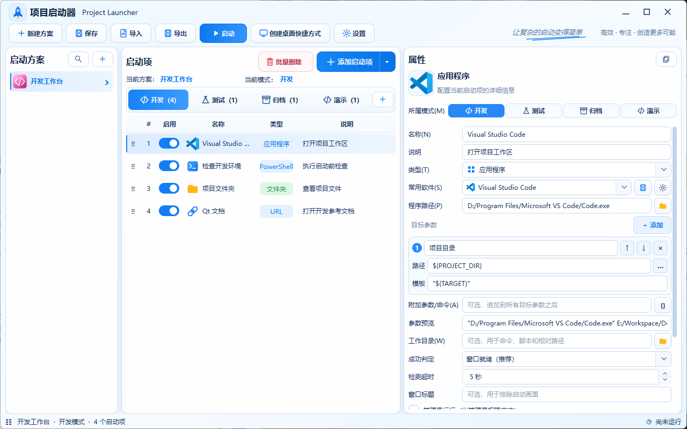
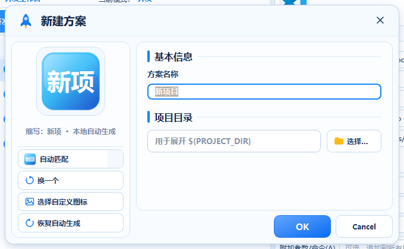
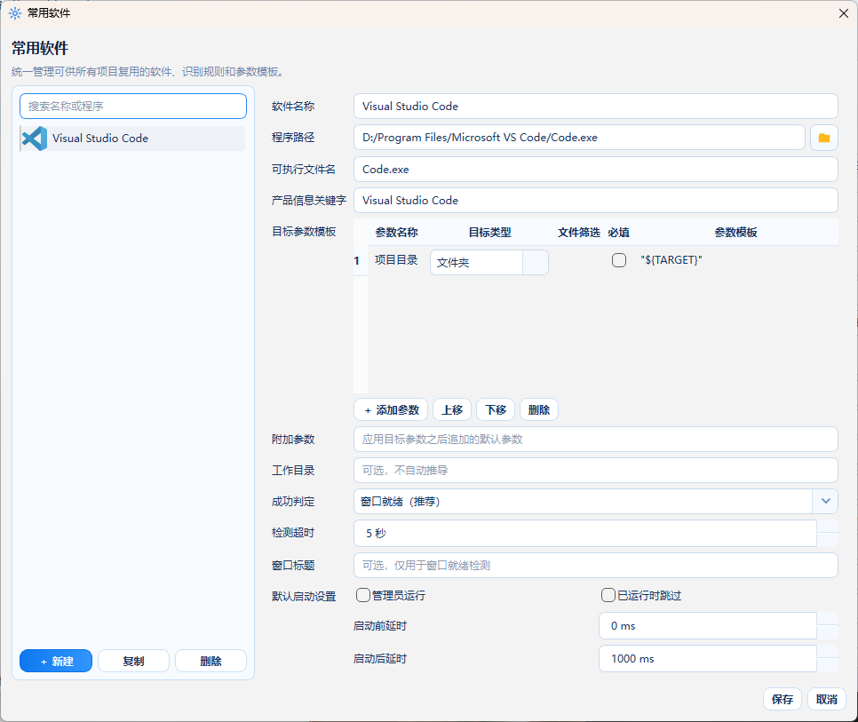

# Project Launcher · 项目启动器

**把一个项目需要的软件、脚本、目录和网页，整理成可以重复执行的启动方案。**

Project Launcher 是一款 Windows 桌面工作环境启动器。为项目配置“开发、测试、归档”等模式，按顺序执行启动项；通过桌面快捷方式选择模式，也能直接进入主界面编辑。

适合多工具开发、嵌入式工程、测试环境和日常工作台。项目图标完全离线生成，无需账号或云端 API。

[下载程序](./ProjectLauncher.exe) · [快速开始](#快速开始) · [多目标参数](#多目标参数与实时预览) · [常用软件](#常用软件配置一次多个项目复用)



## 能做什么

- **项目与模式**：同一项目可有多种工作流；启动项可跨模式共享配置，分别排序。
- **七种启动项**：应用程序、CMD、PowerShell、文件、文件夹、URL、延时。
- **顺序启动与检测**：支持窗口就绪、进程启动、执行结束三种成功判定；失败或超时可重试、跳过或取消。
- **多个打开目标**：每个目标独立配置名称、路径和参数模板，适配 IDE、烧录工具等不同命令行形式。
- **常用软件预设**：统一管理程序、识别规则和参数模板；也可直接将当前属性保存为常用软件。
- **桌面快捷入口**：以项目名创建快捷方式，启动前下拉选择模式，点击“编辑”进入对应项目。
- **紧凑进度卡片**：置顶显示当前执行项与总体进度，成功后停留再渐隐。
- **离线项目图标**：名称缩写、关键词图形、渐变配色、自定义图片及 PNG/ICO 导出。
- **日常管理**：拖放添加、拖拽排序、复制、批量删除、配置导入导出和运行日志。

## 下载与运行

下载 [ProjectLauncher.exe](./ProjectLauncher.exe)，放到具有写入权限的独立文件夹后运行。程序会在自身目录下创建配置、图标缓存和日志。

> 本文按最新源码说明功能。截图来自本目录现有 EXE 的真实界面，使用独立示例配置。现有 EXE 尚未包含最新的配置精简改动；使用下文的集中启动项格式，需要同步到对应的新构建。本文档更新没有替换 EXE。

当前主要支持 Windows。桌面快捷方式、UAC、窗口检测及程序图标提取依赖 Windows 接口。

## 快速开始

1. 点击“新建方案”，填写方案名称及可选的项目目录。
2. 选择自动图标、预设图形或自定义图片。
3. 在所需模式中点击“添加启动项”，选择类型。
4. 在右侧填写程序路径、目标参数或命令，查看实时参数预览。
5. 为应用设置成功判定与超时时间，按需调整启动前后延时。
6. 拖动行调整执行顺序；在属性区勾选启动项所属模式。
7. 点击顶部“保存”，再点击“启动”。

三栏之间可拖动调整宽度；属性较多时向下滚动查看。



### 项目、模式与启动项

| 层级 | 表示什么 | 示例 |
| --- | --- | --- |
| 项目／启动方案 | 一套完整工作环境 | 固件开发、产品测试、日常办公 |
| 模式 | 同一项目的不同启动组合 | 开发、测试、归档 |
| 启动项 | 按顺序执行的一个动作 | 打开编辑器、执行命令、等待一段时间 |

同一启动项可以属于多个模式，属性修改会同步；各模式保留自己的执行顺序。从一个模式删除时，其他模式仍在使用的启动项会保留。

## 启动项类型

| 类型 | 配置内容 | 执行方式 |
| --- | --- | --- |
| 应用程序 | 程序路径、多个目标参数、附加参数 | 运行指定程序，不区分具体 IDE 或工具 |
| CMD | 命令、可选工作目录、是否保持窗口 | `cmd.exe /C`，或保持窗口时使用 `/K` |
| PowerShell | 命令、可选工作目录 | `powershell.exe -NoProfile -Command` |
| 文件 | 文件路径 | 使用系统关联程序打开 |
| 文件夹 | 目录路径 | 使用资源管理器打开 |
| URL | 网址 | 交给系统默认应用打开 |
| 延时 | 等待毫秒数 | 在工作流中插入等待步骤 |

选择程序或 `.lnk` 快捷方式后可自动获取程序名称与图标。快捷方式会解析为真实目标、参数和图标资源，避免显示快捷方式箭头；工作目录不会自动填写。

## 多目标参数与实时预览

应用程序使用“程序路径 + 有序目标参数 + 附加参数”的通用方式，不绑定 VS Code、Qt Creator、Keil 或其他软件。

每个目标可以独立设置名称、文件或文件夹类型、路径、筛选条件、必填标记和参数模板。目标行按顺序组装，最后追加“附加参数/命令”。没有目标参数时，也可以只启动程序。

### 示例：J-Flash 同时指定工程和固件

程序路径设置为实际的 `JFlash.exe`，再添加两个目标：

| 目标名称 | 路径 | 本行参数模板 |
| --- | --- | --- |
| 工程文件 | `E:\Project\Test.jflash` | `-openprj"${TARGET}"` |
| 固件文件 | `E:\Firmware\app.bin` | `-open"${TARGET}",0x08000000` |

两行会依次组成等效参数：

```text
JFlash.exe -openprjE:\Project\Test.jflash -openE:\Firmware\app.bin,0x08000000
```

这里的路径没有空格，预览可以省略双引号；包含空格时会显示必要的引号。具体选项和地址应按所用工具及硬件填写，参数预览不会执行命令。

### 变量

| 变量 | 含义 | 使用位置 |
| --- | --- | --- |
| `${TARGET}` | 当前这一行的目标路径 | 仅目标行的参数模板 |
| `${PROGRAM}` | 当前程序路径 | 支持变量的路径与参数字段 |
| `${WORKDIR}` | 当前工作目录 | 支持变量的路径与参数字段 |
| `${PROJECT_DIR}` | 当前方案的项目目录 | 程序、目标、参数、工作目录等 |
| `${PROJECT_NAME}` | 当前方案名称 | 支持变量的字段 |
| `${MODE_NAME}` | 当前模式名称 | 支持变量的字段 |
| `${APP_DIR}` | 启动器所在目录 | 支持变量的字段 |

`${TARGET}` 在不同行中代表不同路径，可以在同一行模板中多次使用。它不用于全局“附加参数/命令”字段。变量区分大小写；未知变量或未闭合的参数引号会给出失败原因。

目标模板留空时直接传递该行路径；目标路径为空时不生成该行参数，必填目标为空则阻止本项启动。参数支持单双引号分组，包含空格的路径应使用双引号包裹，例如 `--workspace "${TARGET}"`。

“参数预览”随输入实时更新，展示变量展开、参数分组后的等效命令行。预览用来理解传参结果，不是执行日志。

### 项目目录与工作目录

- **项目目录**：整个方案的统一路径基准，用 `${PROJECT_DIR}` 引用。迁移工程时，可减少重复修改绝对路径。
- **工作目录**：进程的起始目录，供命令、脚本或相对路径使用；通常可以留空，不会根据程序或快捷方式自动填写。

## 常用软件：配置一次，多个项目复用

在“设置 → 常用软件管理”中集中维护软件名称、程序路径、识别规则、目标模板及默认启动选项。



使用方式：

1. 在应用程序属性的“常用软件”下拉框中选择预设。
2. 预设填入程序路径、参数模板和默认选项，再填写本项目的目标路径。
3. 手动选择程序且匹配到预设时，可按提示应用。
4. 已经调好当前启动项时，点击“常用软件”行右侧的**保存图标**，直接存为预设；同名预设覆盖前会确认。

预设保存可复用的目标定义，不保存某个项目的具体目标路径。更新预设不会自动改写已有启动项，需要重新套用；重新套用同一预设时保留同名目标的路径，切换其他预设则使用新的目标结构。

## 启动成功检测与顺序控制

当前项达到成功条件后，才开始计算启动后延时，再执行下一项。

| 成功判定 | 何时继续 | 适用场景 |
| --- | --- | --- |
| 窗口就绪 | 找到可见、可响应的匹配窗口，稳定约 1 秒 | 桌面应用，默认选项 |
| 进程启动 | 系统确认进程已创建 | 后台程序、无需等待窗口的工具 |
| 执行结束 | 进程正常结束且退出码为 0 | 命令、脚本、一次性任务 |

- 默认检测超时 **60 秒**，可在启动项属性中单独调整。
- 普通启动项默认启动后延时 **1000 ms**；延时类型只使用自己的延时时间。
- 可用“窗口标题”进一步限定匹配窗口。
- 失败或超时会暂停队列，并提供“重试、跳过、取消”。跳过后继续执行，但整体结果仍保留失败状态。
- 重试时原程序仍在运行，会尽量继续检测原进程，避免重复启动。
- 支持管理员运行及程序已运行时跳过；进程匹配依据实际程序路径及相关进程。

窗口就绪只能确认窗口出现并响应，不能证明软件内部工程已全部加载。需要更长稳定时间时可增加后置延时；CMD 保持窗口时不应选择“执行结束”。

## 桌面快捷方式与进度卡片

点击“创建桌面快捷方式”，生成以**项目名**命名的 Windows 快捷方式，不附加模式名称。


- **启动**：执行下拉框选中的模式。
- **编辑**：打开主界面，定位当前项目和所选模式。
- **取消**：退出这次快捷方式启动。

快捷方式传入的模式作为默认选中项，仍会先显示选择窗口：

```text
ProjectLauncher.exe --project "项目ID" --mode "模式ID"
```

执行时，置顶的单行卡片仅显示当前项及总体进度：


- 主界面点击启动：完成后处理提示卡片，主界面继续保留。
- 快捷方式启动成功且开启自动关闭：停留 **2 秒**，再用约 **1.2 秒**渐隐，随后退出启动器。
- 快捷方式执行失败：提示不会自动消失，用户处理后可点击卡片渐隐退出。
- 关闭自动收起选项时，完成后等待点击。设置中也可控制是否显示进度窗口；失败暂停仍会显示处理入口。
- 取消队列只停止后续执行和检测，已打开的软件不会随启动器一起关闭。

## 离线项目图标

新建方案和项目右键菜单均可设置图标。支持名称缩写、关键词图形、不同渐变配色，以及 ICO、PNG、JPG、JPEG、BMP 自定义图片。

预设图形包括 Qt、芯片、终端、波形、代码、数据库、AI、云平台、相机、安全和工具等；也可恢复自动匹配，或导出 PNG/ICO。每个项目只保留当前生成的图标缓存。

## 数据保存、备份与迁移

运行数据位于程序目录：

```text
ProjectLauncher.exe
config/
├── settings.json                 # 最近项目、模式及提示设置
├── software-presets.json         # 所有项目共用的软件预设
└── projects/
    └── 项目名称__project_….json   # 每项目一个配置文件
cache/icons/                     # 自动项目图标缓存
logs/
├── last-run.log                  # 最近一次运行
└── run-日期-时间.log              # 历史运行日志
```

最新项目格式在顶层集中保存启动项定义，各模式只保存有序 ID 引用；跨模式共享项只保存一份。默认值、空字段和当前类型无关参数会省略，显式关闭、零延时等非默认设置仍保留。

- 项目新增、修改、排序和删除后，点击顶部“保存”写入配置。
- 常用软件通过其保存按钮立即写入全局配置。
- 顶部“导出”备份当前项目，“导入”将项目加入列表；导入后需要保存。
- 项目导出不包含全局常用软件库、自定义图片或被启动的工具。完整迁移可备份整个程序目录，并检查外部文件与路径。
- “设置 → 查看最后一次运行日志”可查看失败原因；历史日志按程序的数量上限清理。

**不同格式之间不做兼容迁移。旧项目配置不能由最新集中格式读取，需要重新创建。** 迁移到其他电脑后，请检查程序、目标、项目目录和可选工作目录。

## 常见问题

**为什么下一项没有立即启动？**

当前项可能正在等待窗口就绪、执行结束或后置延时；失败后需要选择重试、跳过或取消。

**为什么软件窗口出现了，仍然检测超时？**

启动画面、窗口标题条件、单实例转交或窗口暂时无响应都可能影响检测。可调整标题与超时，或按用途选择其他成功判定。

**为什么参数预览省略了双引号？**

不需要分组的参数可以不加引号。预览显示等效传参形式，包含空格等字符时才显示必要的引号。

**删除一个模式中的启动项，会删除其他模式中的同一项吗？**

不会。删除只移除当前模式的引用；其他模式仍使用的启动项保留。

**需要联网吗？**

项目管理、参数配置、图标生成和启动控制都在本地完成。被启动的软件、脚本或网页是否联网，取决于它们自身。
